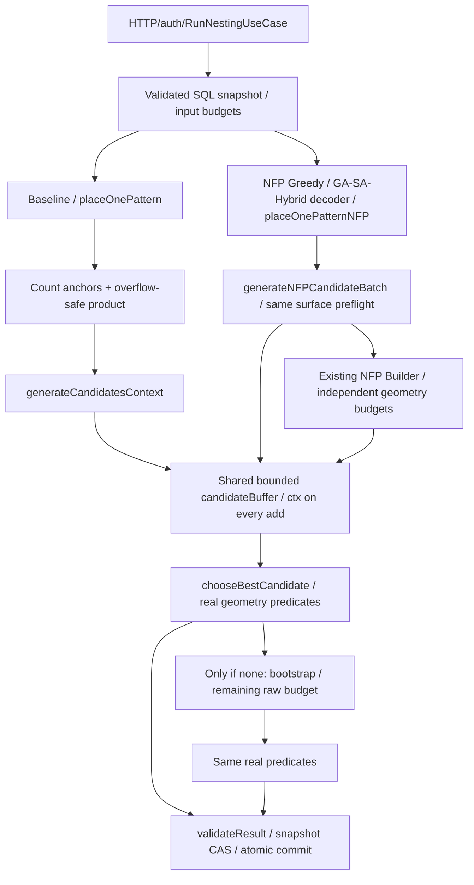

# Этап 11 — безопасный бюджет кандидатов

## Основа и план

HEAD `21eecdbc2a5fa35ddb59028622db3274f8580cb6`, ветка `wip/geometry-editor-v2`, исходное дерево чистое. Baseline source заархивирован вне /tmp до изменений. План: ограниченный fail-before → общий raw/storage budget и ctx → границы/overflow/отмена → реальный HTTP/PostGIS → полный gate. До его завершения этапы 12/13 не начинались.

## Подтверждённые дефекты до исправления

В исходном `generate_candidates.go:9` → `candidate_from_anchors.go:5` отсутствовали предварительный бюджет и ctx; Baseline строил полное произведение anchors×vertices×rotations. При 4096×4096×36 это 603979776 кандидатов×24bytes=14495514624bytes=13.5GiB только payload. Это арифметика и механизм по коду, **не воспроизведённый OOM**.

В `nfp_candidates.go` временные surfaceCandidates/rotationCandidates/seen размножали память; внутренние exterior/holes append не проверяли бюджет непосредственно перед добавлением, а direct helper мог вообще вернуть превышение.

Два настоящих fail-before tests на неизменённом production21eecdb (добавлен только test): Baseline вернул 200004 кандидата,nil error; direct NFP вернул 200017,nil error. Оба assertions FAIL за 0.08s. Ни одного 13GiB запуска: собственный network-none container CPU2/hardRAM256MiB/swapoff/pids128/GOMEMLIMIT64MiB,process timeout20s. Ошибки — assertions,не OOM/timeout.

## Фактический call graph



Ни error,ни cancelled prefix не попадают в selection/commit. Сохраняется только terminal failure metadata по существующему idempotency-контракту.

## Политика и память

Единственный `MaxCandidates=200000` ограничивает **raw enumeration work и stored candidates** на одну попытку размещения, суммарно по всем её углам и fallback. Дубликаты расходуют raw work: это явная новая fail-closed политика, позволяющая ограничить CPU даже при малом unique set. NFP прежде допускал большие duplicate streams; теперь они получают ErrComplexity, а не молча усечённый результат. Под лимитом порядок/выбор прежние. Дедуп Baseline не добавлялся, NFP сохраняет first-seen порядок.

`candidateProduct` проверяет отрицательные counts/нулевые множители и деление limit/n **до** умножения, исключая int overflow. В Baseline preflight выполняется до копии anchors и Transform; общий Context-генератор также защищает direct calls. Реальный ctx проходит через count/copy/rotation/anchor/vertex loops. Все управляемые append идут через единый sink с проверкой перед raw increment/map insertion/slice growth. Capacity растёт явно до cap<=limit; ни один temporary candidate slice на rotation/surface больше не создаётся.

|Стадия|Raw / stored|Память и ownership|ctx / budget|
|---|---|---|---|
|Count anchors|Без candidates|Counts + transient ringVertices copy (не candidates)|Каждое ring; безопасная сумма<=200000|
|Copy anchors|<=200000 points|Одна local точная allocation,<=3.2MB payload|Каждая point|
|Baseline|product<=200000,duplicates сохранены|Один local slice,<=4.8MB payload|Preflight до Transform,каждый add|
|NFP|общий raw<=200000,unique<=raw|Один slice+seen,без rotation/surface copies|Surface-product preflight,каждый add,exterior/holes/occupied loops|
|Bootstrap|<=5raw seeds/angle,остаточный budget|Тот же bounded sink,local map|Консервативная precheck5×angles сохранена|
|Native NFP geometry|Отдельные прежние limits|Полигон builder/cache не является candidate slice|Minkowski/Union/cache не менялись|

При growth старый и новый backing arrays кратковременно существуют вместе; maps/runtime overhead тоже есть. Поэтому 4.8MB — предел **payload retained slice**,не всех RSS. После возврата локальные буферы/seen доступны GC,нет unmanaged goroutines/global caches. Native library work внутри одного вызова остаётся неделимым; бюджет кандидатов не доказывает общий worst-case memory всех геометрических стадий.

Консервативный bootstrap guard оставлен намеренно: raw work считает все 5seed attempts, даже если positions совпадают. Он согласован с новым raw budget. Legacy candidate имеет приоритет. NFP передаёт remaining=MaxCandidates−batch.work,не только unique count; Bootstrap дополнительно ограничивает переданный remaining глобальным максимумом.

## Файлы / compatibility

`candidate_budget.go` — общий budget/product/sink. `anchors.go`, `candidate_from_anchors.go`, `generate_candidates.go` — count/preflight/context enumeration. `nfp_candidates.go` — streaming в один global sink. `place_one_pattern*.go` — настоящий ctx и остаточный raw budget. `bootstrap.go` — тот же sink,прежние seeds.

Неэкспортируемые collectAnchors/candidatesFromAnchors теперь возвращают error; существующие малые tests дополнены только его проверкой,expected values не менялись. Старые non-context wrappers вызывают bounded Context-версию с Background; **production их не использует**. generateCandidates/NFP wrappers сохранили свои error signatures. Bootstrap test helper обновлён под error channel. Нет внешнего breaking API/новых dependencies/миграций.

Новые `candidate_budget_regression_test.go` и `integration/candidate_budget_test.go` проверяют исходные дефекты,границы,переполнение,отмену,ограниченные allocations и сохранность SQL.

## Тесты и найденная ошибка fixture

- Малые старые golden generators/anchor order,bootstrap matrix и fixed Hybrid — PASS. Hybrid сохраняет 8205calls/6923repeated/0mismatches,9placements,usedArea4800/height60.
- 0/1/limit−1/limit/limit+1,MaxInt products,zero×MaxInt,negative counts,capacity<=limit,duplicates consuming raw work — PASS.
- Реальная cancellation внутри Baseline vertex loop и NFP holes после 100Err checks,нулевой partial; DeadlineExceeded до работы — PASS.
- Synthetic big NFP возвращает ограниченный 200001-point polygon: новая проверка не отдаёт partial и не превышает sink cap — PASS.
- Bounded maximum4096×4096×36distinct angles: отказ до Transform,0transform calls,allocation delta<1MiB. Никакого создания 603m кандидатов.

Первый SQL fixture256×256×4 неверно предполагал,что GA/SA перебирают 4 угла в одном decode. Они используют один выбранный угол;65536 входит в лимит. Baseline/NFP отказали правильно,GA/SA/Hybrid достигли test timeout10s. Это ошибка предпосылки теста; логи FAIL сохранены,watchdog90s/завершение собственного binary не оставили jobs. Fixture усилен до **512×512>200000 даже для одного угла**,без ослабления assertions.

Исправленный SQL тест в отдельном own capped runner:5 алгоритмов×keep/replace×preview/save×first/replay=40POST,все 400validation_error. Ровно 2Optimize/case,повтор UUID не вычисляет. Старый placement99 остаётся,history0,ready0;отмена с реальным SQL не меняет данные. Full suite дополнительно проверяет настоящие native deadline/cancel/stale/exact preview save и JWT/two-PID races.

## Среда / команды / свежий gate

Go1.26.2,Node24.22.2,golangci2.13.2. Фактический SQL gate:database=nesting_test,user=postgres,PostGIS3.4. Own test runner nesting-stages11-13-sql:CPU2,hardRAM768MiB,swapoff,pids256,GOMEMLIMIT256MiB,readonlyroot,exec tmpfs;network namespace только прежнего выделенного test PostgreSQL. Сам PostgreSQL не перезапускался. Cwd=/work/internal/integration,миграции=/work/migrations;12private tables проверены до fixture writes. Race CGO binaries через совместимый host-loader/libc,родитель и APIchildren реально instrumented.

Команды:go test -count=1 ./...;go vet ./...;golangci-lint run ./...;go test -race -count=1 -p=1 -timeout=20m ./internal/nesting ./internal/geometry/nfp ./internal/usecase/nesting ./internal/transport/http/handler. Frontend build/lint/72unit. Full SQL binary -test.count=1 -test.v -test.timeout=300s;targetSQLrace включает CandidateBudgetHTTPPreservesLayout/RadialPreviewSavedExactly/NativeDeadlinePreservesSavedLayout/RealProcessLifecycle.

Opt-in bounded: NESTING_CANDIDATE_EXPERIMENT=1 /work/final.test -test.run '^TestCandidateBudgetWatchdog$' -test.count=3 -test.v -test.timeout=15s. Фактические результаты/финальный Git snapshot добавляются после завершения gate. Обычный SKIP этого explicit measurement не считается PASS;он отдельно выполнен.

## Границы / ручная проверка

Исходный пользовательский SVG отсутствует. Полнота эвристики/оптимальность/произвольные 500 сложныхдеталейза 120s не доказаны. Человеческая UX-приёмка отложена; позднее владелец проверит понятность сложности/исправление параметров и собственный SVG. UI/CSS не менялись;новый browser gate запланирован этапом 13. Нет изменений рабочейБД,.env,контейнеров пользователя,commit/push/merge.


## Финальный gate этапа 11 — PASS

Свежие Go test count1/vet/golangci-lint — PASS,0issues; frontend build/lint/72unit — PASS. Последовательный race count1: nesting322.662s,nfp1.360s,usecase116.886s,handler1.018s — PASS без race reports. Полный PostGIS и адресный SQL race четырёх suites — PASS; relevant SQL не SKIP. Browser здесь SKIP,плановый этап 13.

Три финальных early-refusal:0.645/0.441/1.095ms,65536allocatedbytes/run (копия 4096Point из ringVertices;не candidate list),0Transform. Combined memory.peak bounded container=62177280bytes,OOM/OOMkill0;это включает binary/tmpfs и fail-before,не per-opRSS. Никакого 13.5GiB allocation.

git diff --check и untracked whitespace — PASS. HEAD/ветка исходные. Own test jobs/APIchildren закончились;собственные stage11 runner containers завершены перед 12,working PostgreSQL не останавливался. Нетмиграций/.env изменений.

```text
 backend/internal/nesting/anchors.go                |  78 +++++--
 backend/internal/nesting/anchors_test.go           |  11 +-
 backend/internal/nesting/bootstrap.go              |  11 +-
 backend/internal/nesting/bootstrap_test.go         |  11 +-
 backend/internal/nesting/candidate_from_anchors.go |  56 +++--
 .../nesting/candidate_from_anchors_test.go         |  12 +-
 backend/internal/nesting/generate_candidates.go    |  63 +++---
 backend/internal/nesting/nfp_candidates.go         | 247 ++++++++-------------
 backend/internal/nesting/place_one_pattern.go      |  25 ++-
 backend/internal/nesting/place_one_pattern_nfp.go  |   5 +-
 10 files changed, 258 insertions(+), 261 deletions(-)
```

```text
 M backend/internal/nesting/anchors.go
 M backend/internal/nesting/anchors_test.go
 M backend/internal/nesting/bootstrap.go
 M backend/internal/nesting/bootstrap_test.go
 M backend/internal/nesting/candidate_from_anchors.go
 M backend/internal/nesting/candidate_from_anchors_test.go
 M backend/internal/nesting/generate_candidates.go
 M backend/internal/nesting/nfp_candidates.go
 M backend/internal/nesting/place_one_pattern.go
 M backend/internal/nesting/place_one_pattern_nfp.go
?? backend/internal/integration/candidate_budget_test.go
?? backend/internal/nesting/candidate_budget.go
?? backend/internal/nesting/candidate_budget_regression_test.go
?? docs/stage11_candidate_budget_safety_report.md
```
Обычный stat не включает untracked.

Уточнение аудита: существующий ringVertices возвращает копию,а не view. Preflight4096-point pattern поэтому выделяет 64KiB. Это ограниченная vertex-copy при API-лимитах,не 603m кандидатов;накопление candidate list блокируется до Transform. Глобальная семантика/ownership ringVertices не менялась.
